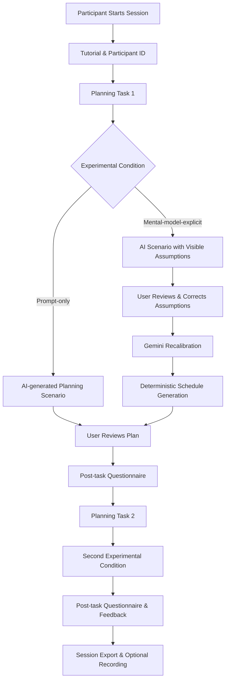
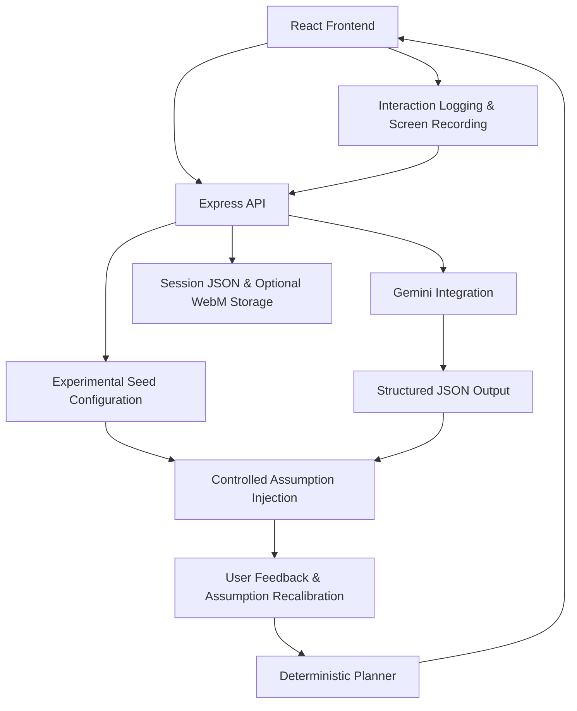

# Trustworthy Human–AI Collaboration

**A research prototype exploring how transparent AI assumptions and human feedback influence AI-assisted planning.**

Trustworthy Human–AI Collaboration is an interactive weekly planning application designed to study how people work with AI systems when the AI either provides recommendations directly or makes its underlying assumptions explicit.

The prototype compares two interaction approaches:

- **Prompt-only:** AI-assisted planning without explicitly exposing the assumptions behind its recommendations.
- **Mental-model-explicit:** AI-assisted planning that makes assumptions and constraints visible, allowing users to inspect and correct them.

The application combines Gemini-powered structured generation, deterministic scheduling logic, human feedback, counterbalanced study tasks, and interaction logging.

The central research question:

**Does making an AI system's assumptions visible help people better understand, evaluate, and collaborate with its recommendations?**

---

## Project Resources & Demo

Explore the research, implementation, and application through the following resources.

### 1. Project Presentation

An overview of the research motivation, problem framing, study design, methodology, and human–AI collaboration framework.

[**View Project Presentation (PDF)**](HAI_Final_Course_Project.pdf)

### 2. Research Report

The complete research report covering the research background, related work, system architecture, implementation, experimental methodology, and findings.

[**View Research Report (PDF)**](HAI_Project_Final_Report.pdf)

### 3. Application Demo

A walkthrough of the application demonstrating the two interaction conditions, assumption modelling, user feedback, and AI-assisted recalibration.

<video src="demo-video.mp4" controls width="100%"></video>

---

## Project Overview

AI systems can generate useful recommendations, but users may not understand the assumptions driving those recommendations. When those assumptions are inaccurate, users can struggle to identify why a recommendation does not fit their needs.

This prototype explores a more transparent approach to AI-assisted planning.

Rather than treating the model's output as a final answer, the application exposes planning assumptions as part of the interaction. Users can review and modify those assumptions, triggering recalibration of the proposed plan.

The project also includes a structured comparative study to examine how participants interact with the two interface conditions.

## Key Features

### 1. LLM-powered planning

Integrates Google's Gemini API to generate structured planning scenarios.

The model produces JSON containing:

- Planning tasks
- Constraints
- Assumptions
- Supporting context

Structured outputs allow the application to process generated content consistently rather than relying on unstructured conversational responses.

If the Gemini API is unavailable or no API key is configured, the backend provides deterministic fallback scenarios.

### 2. Explicit assumption modelling

The mental-model-explicit interface makes the assumptions behind planning recommendations visible to users.

Participants can inspect the assumptions, identify mismatches with their actual circumstances, and modify the information used by the planner.

This makes the AI's reasoning context more transparent and gives users a concrete way to challenge its recommendations.

### 3. Human feedback and recalibration

Users can modify assumptions and request recalibration.

The application uses Gemini to interpret the updated information and produce revised assumptions. The updated assumptions are then passed into a deterministic scheduling function.

This creates a human-in-the-loop workflow:

1. AI generates a planning scenario.
2. User reviews the assumptions.
3. User identifies and corrects mismatches.
4. AI recalibrates the assumptions.
5. Deterministic scheduling logic generates an updated plan.

The user remains actively involved in shaping the final outcome.

### 4. Deterministic planning safeguards

The application separates LLM-generated content from schedule construction.

Gemini assists with generating and recalibrating assumptions, while deterministic planner logic builds the resulting schedule.

The server also reintroduces a predefined target assumption from the experiment's seed configuration, keeping the experimental manipulation controlled.

This separation helps distinguish probabilistic language-model behaviour from the application logic responsible for producing the schedule.

### 5. Controlled comparative study

The prototype includes a within-participant comparative study with two planning tasks.

Participants experience both interaction conditions, with condition order counterbalanced across sessions to reduce ordering effects.

The study includes:

- Participant identification using a generated UUID.
- An introductory interface tutorial.
- Two planning tasks with counterbalanced condition order.
- Post-task questionnaires.
- Optional open-ended feedback.
- Session-level interaction and timing records.

Condition labels are hidden from participants during the study and retained in the exported session data for analysis.

### 6. Interaction logging and session capture

The application supports collecting interaction data to evaluate the planning experience.

Captured information includes:

- Participant and session identifiers.
- Experimental condition and task order.
- Planning task responses.
- Questionnaire responses.
- Optional open-ended feedback.
- Session interaction data.
- Optional browser screen recordings in WebM format.

When the API is running, session data can be saved as JSON, with optional recording uploads.

This provides a basis for examining user interactions across the two interface conditions.

## How It Works



## Experimental Design

The application implements a counterbalanced two-condition study.

| Dimension | Implementation |
|---|---|
| Study design | Within-participant comparison |
| Interaction conditions | Prompt-only and mental-model-explicit |
| Planning tasks | Two |
| Condition ordering | Counterbalanced |
| Participant identification | Generated UUID |
| Feedback | Post-task questionnaires and optional open-ended responses |
| Data collection | Session JSON and optional WebM recording |

The condition order is controlled using a 2 × 2 ordering scheme, allowing participants to encounter the conditions in different sequences.

The application keeps experimental condition labels and scenario identifiers out of the participant-facing interface. These are retained in exported data to support subsequent analysis.

## Technical Architecture

The application separates the participant-facing interface, backend API, LLM integration, and deterministic planning logic.



### Core components

| Component | Responsibility |
|---|---|
| React frontend | Participant interface and planning interactions |
| TypeScript | Frontend application logic and type safety |
| Vite | Development server and frontend build |
| Express | Backend API and session handling |
| Google Gemini API | Structured scenario generation and assumption recalibration |
| Deterministic planner | Schedule construction after assumption updates |
| Browser MediaRecorder | Optional screen recording |
| Session storage | JSON session data and optional WebM recordings |

## Technology Stack

| Layer | Technology |
|---|---|
| Frontend | React 19 |
| Language | TypeScript |
| Build tooling | Vite |
| Backend | Node.js, Express |
| LLM integration | Google Gemini API |
| Data format | JSON |
| Screen recording | Browser MediaRecorder API |
| Development tooling | ESLint, TypeScript |

## Getting Started

### Prerequisites

- Node.js and npm
- Google Gemini API key (optional; deterministic fallback scenarios are available without one)

### 1. Clone the repository

```bash
git clone https://github.com/pooja-krishan/Trustworthy-Human-AI-Collab.git

cd Trustworthy-Human-AI-Collab
```

### 2. Install dependencies

```bash
npm install
```

### 3. Configure the backend

Create a local environment configuration file:

```bash
cp .env.server.example .env.server
```

Add your Gemini API key:

```env
GEMINI_API_KEY=your-gemini-api-key
```

The application uses `gemini-2.0-flash` by default. You can override the model using:

```env
GEMINI_MODEL=your-supported-gemini-model
```

Keep API keys out of source control.

### 4. Start the application

```bash
npm run dev
```

This starts both the Vite frontend and Express API.

- Frontend: `http://localhost:5173`
- Backend API: `http://localhost:8787`

The Vite development server proxies API requests to the backend.

### Available scripts

| Command | Description |
|---|---|
| `npm run dev` | Starts frontend and backend together |
| `npm run dev:client` | Starts the frontend only |
| `npm run server` | Starts the Express API only |
| `npm run build` | Builds the production frontend |
| `npm run lint` | Runs ESLint |
| `npm run preview` | Previews the production frontend build |

## Project Structure

```text
Trustworthy-Human-AI-Collab/
│
├── public/
├── scripts/
│   └── free-api-port.mjs
│
├── server/
│   ├── index.mjs
│   ├── llmPrompt.js
│   └── seeds.json
│
├── src/
│   ├── content/
│   │   └── participantScenarios.ts
│   └── planner/
│       └── planner.ts
│
├── docs/
│   ├── project-presentation.pdf
│   ├── presentation-preview.png
│   ├── research-report.pdf
│   ├── report-preview.png
│   └── application-demo.webm
│
├── .env.server.example
├── package.json
├── tsconfig.json
├── vite.config.ts
└── README.md
```

## Design Principles

**Transparency over blind trust**

Make important assumptions visible so users can understand and challenge the context behind AI recommendations.

**Human oversight**

Treat AI-generated recommendations as inputs to a collaborative process rather than unquestionable answers.

**Separation of AI and application logic**

Use LLMs for language-based generation and interpretation while relying on deterministic application logic for schedule construction.

**Controlled experimentation**

Use counterbalanced conditions and consistent tasks to support a more meaningful comparison of AI interaction designs.

**Responsible data collection**

Use participant identifiers and structured session records to support research analysis. Screen recording is optional and requires browser permission.

## Limitations

- The application is a research prototype, not a production scheduling or calendar-management platform.
- Gemini-generated assumptions and recalibration outputs may be inaccurate and require user review.
- The deterministic planner operates within the predefined scheduling logic and constraints implemented in the application.
- Experimental findings require participant data and appropriate statistical analysis; the application itself does not establish that one interface condition is superior.
- Optional screen recordings depend on browser permissions and available storage.
- The included backend writes session files under `data/sessions/`. Production deployment requires appropriately configured persistent storage and security controls.

## Future Directions

Potential extensions include:

- More sophisticated user mental-model representations.
- Additional planning scenarios and task domains.
- Expanded evaluation metrics for trust, understanding, and decision quality.
- Comparative analysis of user behaviour across interface conditions.
- Integration with external tools and real-world scheduling systems.
- More robust deployment and session data management.

---

*Exploring how transparent assumptions, structured feedback, and human oversight can make AI collaboration more trustworthy.*
